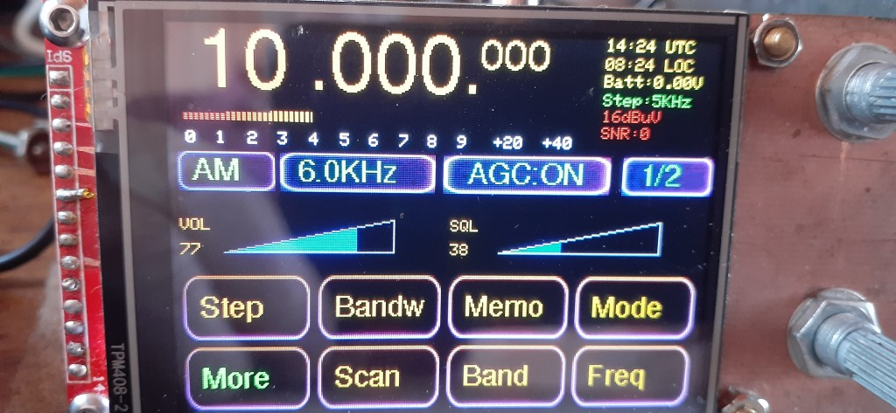
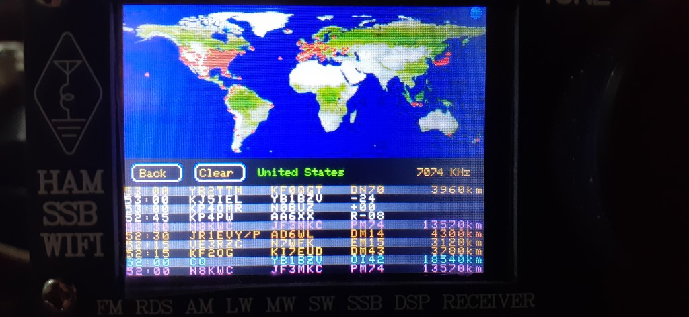

# SI4732-receiver
This firmware is for receivers that use a SI473x chip together with an ESP32 MCU and an ILI9341 or ST7789 display. It contains a ported version with many (but not all) features of my wide band receiver project.
The firmware will run on diy receivers that follow the "common" wiring scheme that has been published several times. It has been optimized for a VHF extension with an AD831 mixer and will then also cover 118-148MHz. An example schematic for the VHF/SW frontend has been added. It will perform as a solid air band receiver with an high IP3. It will also run on some versions of the ATS25 receiver. 
CW, RTTY, SSTV, WEFAX and FTx decoders are included. A web interface is included. A KiwiSDR client lets you select a KiwiSDR and listen to the current frequency.
Please note that this firmware is free for personal use, but not commercial use. 

